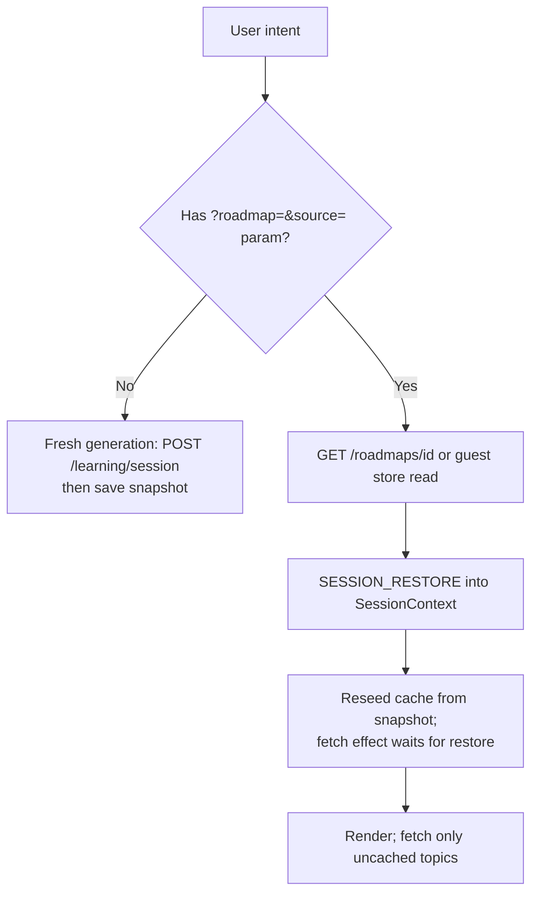
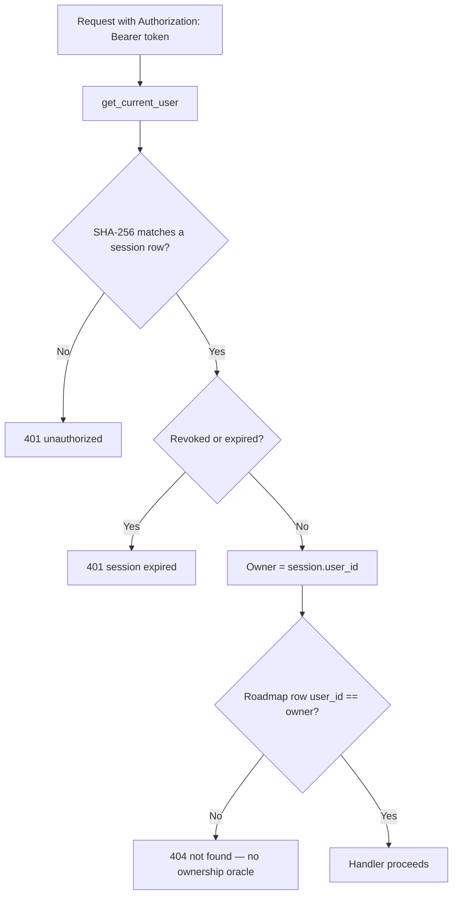
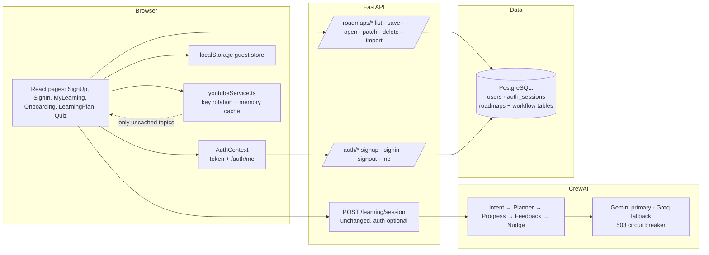

# Saarthi.AI — Authentication, Roadmaps & Guest Mode Flows

Module/entity names below are the real ones. Error paths use the repo's
`ErrorResponse` envelope (`message` + `error_code`).

## Setup

PostgreSQL must be reachable, then:

```bash
python -m backend.scripts.create_tables   # creates tables + users.password_hash
```

`users.password_hash` is added idempotently for databases created before
authentication existed. No environment variables were added; sessions use
opaque bearer tokens, so no signing secret is required.

### Production deployment — database initialization (Render)

The production Render backend connects to a provisioned PostgreSQL database via
``DATABASE_URL``, but Render does **not** initialize the application schema.
Before signup/signin/roadmap endpoints work, the tables must exist in the
production database:

```bash
# Run once against Render's production database (Render shell / one-off).
# Use the production DATABASE_URL; never hard-code credentials.
DATABASE_URL=<render-production-database-url> MOCK_MODE=false \
  python -m backend.scripts.create_tables
```

The command is idempotent: ``create_all`` only creates tables that are still
missing, and ``users.password_hash`` is added with ``ADD COLUMN IF NOT EXISTS``.
It never drops or alters existing data, so it is safe to re-run.

Future deploys are additionally self-healing: ``backend/main.py`` runs
``ensure_schema()`` inside the FastAPI ``lifespan`` startup hook, so any table
that is still missing (e.g. a freshly provisioned Render database) is created
automatically when the backend starts. No separate migration step is required
going forward, though running the explicit command above is still the
recommended way to initialize a brand-new production database before first
traffic.

**Verification after initialization** — connect to the production database and
confirm the required tables and columns exist (do not expose credentials in
output):

```sql
\dt                     -- lists users, auth_sessions, roadmaps, learner_intents,
                        -- learning_plans, progress, feedback_history, nudge_history
\d users                -- confirms users.password_hash column exists
```

Backend production environment variables (set in Render, never committed):
``DATABASE_URL``, ``GEMINI_API_KEY_1..4`` (at least one required unless
``MOCK_MODE=true``), ``GROQ_API_KEY_1..4``, ``GROQ_MODEL``, ``GROQ_BASE_URL``,
``REDIS_URL``, ``YOUTUBE_API_KEY_1..4``, ``GOOGLE_CLIENT_ID``,
``GOOGLE_CLIENT_SECRET``.

### Production configuration — frontend base URL

The frontend reads its backend base URL at build time from
`VITE_API_BASE_URL` (`frontend/src/api/apiClient.ts`). In production this must
point to the deployed backend service (the Railway FastAPI host), **not** to a
Vercel/frontend host and not to `localhost`:

```env
VITE_API_BASE_URL=https://<railway-backend-domain>
```

It is set in the Vercel project settings and never committed to Git. If it
points at the wrong host, every auth request (signup, signin, signout, `/me`)
and every roadmap request fails with HTTP 404 because that host does not serve
the `/auth/*` or `/roadmaps/*` routes. Correcting it requires a frontend
redeploy; verify the deployed `POST /auth/signin` endpoint afterward before
declaring the incident resolved.

Backend production environment variables (set in Railway, never committed):
`DATABASE_URL`, `GEMINI_API_KEY_1..4` (at least one required unless
`MOCK_MODE=true`), `GROQ_API_KEY_1..4`, `GROQ_MODEL`, `GROQ_BASE_URL`,
`REDIS_URL`, `YOUTUBE_API_KEY_1..4`, `GOOGLE_CLIENT_ID`,
`GOOGLE_CLIENT_SECRET`.

## Guest journey — generate, save locally, reopen without regeneration

```mermaid
flowchart TD
    A[Guest opens /onboarding] --> B[Completes 5-step wizard]
    B --> C[POST /learning/session — no token needed]
    C --> D[CrewAI workflow runs: intent → planner → progress → feedback → nudge]
    D --> E[Frontend saves snapshot to localStorage\nsaarthi-guest-roadmaps-v1]
    E --> F[/learning-plan?roadmap=gid&source=guest]
    F --> G[Videos load per topic via youtubeService]
    G --> H[Fetched videos merged into the guest record]
    H --> I[User leaves / refreshes]
    I --> J[Reopen restores session + video cache from localStorage]
    J --> K{Topics missing from cache?}
    K -- No --> L[Render cached cards — zero YouTube calls]
    K -- Yes --> M[Fetch only missing topics, then merge]
```

Guest records carry a banner: stored only in this browser, unavailable on
other devices. A manual **Refresh resources** button is the only refetch path
besides never-before-seen topics.

## Registered-user journey — auth, persistence, My Learning, sign-out

```mermaid
flowchart TD
    A[Visitor opens /signup] --> B[POST /auth/signup\nname + email + PBKDF2-hashed password]
    B --> C[201: user profile + bearer token]
    C --> D[Token in localStorage; /auth/me restores login on refresh]
    D --> E[Generate via /onboarding as usual]
    E --> F[Frontend POSTs snapshot to /roadmaps]
    F --> G{Server save succeeds?}
    G -- Yes --> H[/learning-plan?roadmap=id&source=server]
    G -- No --> H2[Same snapshot saved as guest copy]
    H2 --> H3[/learning-plan?roadmap=gid&source=guest]
    H --> I[Topic toggles PATCH /roadmaps/id progress;\nquiz submissions append to quiz history]
    H3 --> I
    I --> J[User opens /my-learning: GET /roadmaps]
    J --> K[Open restores exact snapshot + cached videos]
    K --> L[Optional: DELETE /roadmaps/id]
    M[Navbar account menu] --> N[POST /auth/signout revokes token]
```

Sign-in failures always return 401 `invalid_credentials` without revealing
whether the email or password was wrong. Duplicate registration returns 409
`email_taken`, rendered as a dedicated notice with a link to `/signin`.
Expired sessions clear local state without forced navigation: forms keep
their errors, `MyLearning` redirects itself, and roadmap pages show restore
errors; sign-out additionally reloads to `/` so no in-memory session bleeds
across local users.

## Guest-to-account migration without regeneration

```mermaid
flowchart TD
    A[Guest roadmap in localStorage] --> B[User signs in]
    B --> C[/my-learning lists guest roadmaps under On this device]
    C --> D[Click Import]
    D --> E[POST /roadmaps/import with guest_id + full snapshot]
    E --> F{guest_import_id seen for this user?}
    F -- Yes --> G[Return existing roadmap — no duplicate]
    F -- No --> H[Create roadmap row, resources + progress + quiz intact]
    H --> I[Only on server success: delete guest-local copy]
```

No agent rerun and no YouTube calls occur at any step of migration.

## New roadmap vs restoring a saved roadmap



Restored snapshots without a progress report get a minimal one synthesized
from plan phases (0%, first phase current) so topic toggles keep working.

## Authentication, token validation, ownership checks



Ownership never comes from a frontend-supplied user id. Passwords are
PBKDF2-HMAC-SHA256 with per-user salts; verification is constant-time.
Tokens are random 256-bit values; only hashes persist. No credential or hash
ever appears in a response, log, or frontend store besides the single
`saarthi-auth-token` key holding the active bearer token.

## Architecture



Saved YouTube resources short-circuit discovery: `LearningPlanPage` seeds its
per-topic fetch cache from `resources_json` (server) or the guest record
before deciding what to request, and merges fresh results back into the same
store. Reopen and refresh therefore render cached cards with zero
`googleapis.com/youtube` calls unless the learner presses **Refresh
resources** or a genuinely new topic appears.

## Design system — what the Lumen redesign changed (frontend only)

The landing page (`/`) and the onboarding wizard (`/onboarding`) are rendered
with the Hallmark Lumen system: a violet-black paper ground, roman-serif
lowercase heads with one rose-accented verb, mono readouts for measured figures,
a warm brass control accent, and hairline rules instead of shadows. The system
is scoped to `.lumen` shells (`frontend/src/styles/globals.css`); tokens live in
`frontend/src/styles/tokens.css`; the locked rules are in `DESIGN.md` at the
repo root, and the redesign's stamps, waivers, and kept-content records sit at
the top of `globals.css`. Every other route keeps the legacy base: `AppLayout`
early-returns for `/`, `/onboarding`, `/signin`, `/signup`, so workspace pages
(dashboard, chat, quiz, interview, calendar) must not move.

Frontend terms in the redesigned surfaces: the wizard's progress path and the
hero diagram share the five-answer vocabulary (goal, level, study time,
deadline, preferences); the LoadingScreen reads the five answers back in mono
with the deadline humanized (`formatTargetDate`); errors render as `.l-alert`
and validation notes as `.l-field-note`; controls are `.l-pill` (brass primary /
hairline ghost) and choices are `.l-choice` wells. Behavior is unchanged from
the pre-redesign flows described above — the wizard still posts to
`POST /learning/session`, guest submissions still save to
`saarthi-guest-roadmaps-v1` and navigate with `source=guest`, authed
submissions save via `POST /roadmaps` and navigate with `source=server`, and
`frontend/src/components/onboarding/validation.ts` is byte-identical.

## Failure behavior (observed)

During a Gemini 503 storm, a full generation measured **360.3s** (past the
180s frontend timeout) because every agent stage retried all 4 keys at
~25s per attempt before Groq was tried. The circuit breaker in
`backend/core/llm.py` trips after 2 consecutive server-side failures,
bypasses Gemini for 180s via a non-retryable sentinel, and routes straight
to Groq; a storm-hit workflow then completed in **76.88s**. The breaker and
its unit checks live in `backend/scripts/test_llm_fallback.py`.

## Production outage runbook — sign-in / sign-up returning 500 `signin_failed` or `signup_failed`

**Symptom:** `POST /auth/signin` and `POST /auth/signup` return 500; `GET /health`
returns 500 `database_unavailable`; `/` and `/docs` still return 200. The
application is up; the database is not.

**Root cause:** The production Render backend (`https://saarthi-ai-kcx1.onrender.com`)
runs a free Render Postgres. Free Render Postgres databases expire 30 days after
creation, are inaccessible during a 14-day grace window, and are deleted with
all data afterwards. Instant `SELECT 1` failures (~100 ms) fit an expired or
suspended instance. The local shell cannot reach the production Render DB;
diagnosis happens through the public HTTP endpoints `/health`,
`/auth/signin`, `/auth/signup` only.

**What the fix does (code side, deployed):** `backend/api/routes/auth.py` now
distinguishes a connection-level outage from a logic failure. A database
outage returns 503 `database_unavailable` with
`"The service is temporarily unavailable. Please try again in a few minutes."`;
the frontend (`apiClient.ts` → `classifyApiError`) renders the same message
even without a JSON envelope. Non-outage failures keep the existing 500 /
401 / 200 / 201 shapes byte-identical. No destructive DB change; fixes are
idempotent.

**Owner action (Render Dashboard — required to restore service):**
1. Open the Render Dashboard → the `saarthi-ai-kcx1` Postgres database.
2. If inside the 14-day grace window: upgrade the database to a paid compute
   plan. The instance becomes reachable again and existing data is preserved.
3. If past the grace window (database deleted): provision a new paid Postgres
   instance, set `DATABASE_URL` on the backend service, redeploy, then run
   the idempotent schema initialization against the new database:

   ```bash
   DATABASE_URL=<new-render-production-database-url> MOCK_MODE=false \
     python -m backend.scripts.create_tables
   ```

   `create_all` only creates missing tables and adds
   `users.password_hash` with `ADD COLUMN IF NOT EXISTS`; nothing is dropped
   or altered, so existing data is never at risk. `backend/main.py` also runs
   `ensure_schema()` inside the FastAPI `lifespan` startup hook, so missing
   tables self-heal on every start.

**Verification after restore:** `GET /health` → 200 `{"database": "connected"}`;
`POST /auth/signin` with a nonexistent throwaway email → 401
`invalid_credentials` (lookup works); real credentials → 200. Redeploy the
frontend if `VITE_API_BASE_URL` points at the wrong host.

**Do not:** run `python -m backend.scripts.create_tables` against the expired
production DATABASE_URL from a local shell (unreachable); chase inherited
base-layer `FAIL`s (`.page-heading`, `.glass-panel`) — out of scope; or make
any destructive database change.
