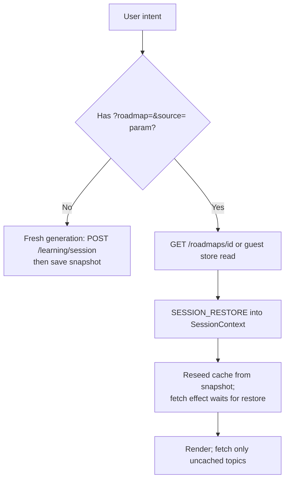
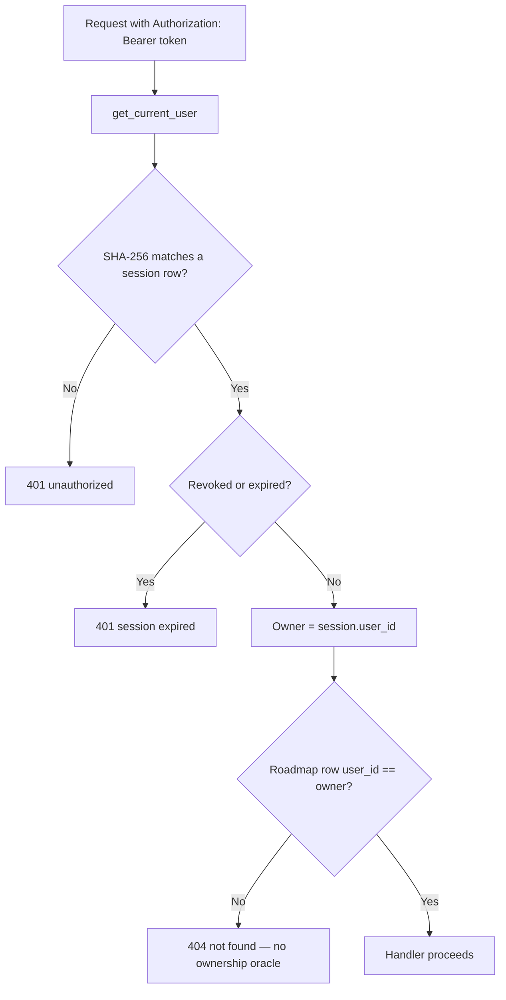
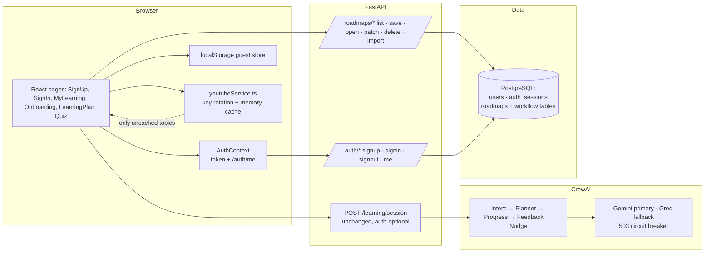

# Saarthi.AI — Authentication, Roadmaps & Guest Mode Flows

Module/entity names below are the real ones. Error paths use the repo's
`ErrorResponse` envelope (`message` + `error_code`).

## Setup

PostgreSQL must be reachable, then:

```bash
python -m backend.scripts.create_tables   # creates tables + users.password_hash
```

`users.password_hash` is added idempotently for databases created before
authentication existed. No environment variables were added; sessions use
opaque bearer tokens, so no signing secret is required.

### Production configuration — frontend base URL

The frontend reads its backend base URL at build time from
`VITE_API_BASE_URL` (`frontend/src/api/apiClient.ts`). In production this must
point to the deployed backend service (the Railway FastAPI host), **not** to a
Vercel/frontend host and not to `localhost`:

```env
VITE_API_BASE_URL=https://<railway-backend-domain>
```

It is set in the Vercel project settings and never committed to Git. If it
points at the wrong host, every auth request (signup, signin, signout, `/me`)
and every roadmap request fails with HTTP 404 because that host does not serve
the `/auth/*` or `/roadmaps/*` routes. Correcting it requires a frontend
redeploy; verify the deployed `POST /auth/signin` endpoint afterward before
declaring the incident resolved.

Backend production environment variables (set in Railway, never committed):
`DATABASE_URL`, `GEMINI_API_KEY_1..4` (at least one required unless
`MOCK_MODE=true`), `GROQ_API_KEY_1..4`, `GROQ_MODEL`, `GROQ_BASE_URL`,
`REDIS_URL`, `YOUTUBE_API_KEY_1..4`, `GOOGLE_CLIENT_ID`,
`GOOGLE_CLIENT_SECRET`.

## Guest journey — generate, save locally, reopen without regeneration

```mermaid
flowchart TD
    A[Guest opens /onboarding] --> B[Completes 5-step wizard]
    B --> C[POST /learning/session — no token needed]
    C --> D[CrewAI workflow runs: intent → planner → progress → feedback → nudge]
    D --> E[Frontend saves snapshot to localStorage\nsaarthi-guest-roadmaps-v1]
    E --> F[/learning-plan?roadmap=gid&source=guest]
    F --> G[Videos load per topic via youtubeService]
    G --> H[Fetched videos merged into the guest record]
    H --> I[User leaves / refreshes]
    I --> J[Reopen restores session + video cache from localStorage]
    J --> K{Topics missing from cache?}
    K -- No --> L[Render cached cards — zero YouTube calls]
    K -- Yes --> M[Fetch only missing topics, then merge]
```

Guest records carry a banner: stored only in this browser, unavailable on
other devices. A manual **Refresh resources** button is the only refetch path
besides never-before-seen topics.

## Registered-user journey — auth, persistence, My Learning, sign-out

```mermaid
flowchart TD
    A[Visitor opens /signup] --> B[POST /auth/signup\nname + email + PBKDF2-hashed password]
    B --> C[201: user profile + bearer token]
    C --> D[Token in localStorage; /auth/me restores login on refresh]
    D --> E[Generate via /onboarding as usual]
    E --> F[Frontend POSTs snapshot to /roadmaps]
    F --> G{Server save succeeds?}
    G -- Yes --> H[/learning-plan?roadmap=id&source=server]
    G -- No --> H2[Same snapshot saved as guest copy]
    H2 --> H3[/learning-plan?roadmap=gid&source=guest]
    H --> I[Topic toggles PATCH /roadmaps/id progress;\nquiz submissions append to quiz history]
    H3 --> I
    I --> J[User opens /my-learning: GET /roadmaps]
    J --> K[Open restores exact snapshot + cached videos]
    K --> L[Optional: DELETE /roadmaps/id]
    M[Navbar account menu] --> N[POST /auth/signout revokes token]
```

Sign-in failures always return 401 `invalid_credentials` without revealing
whether the email or password was wrong. Duplicate registration returns 409
`email_taken`, rendered as a dedicated notice with a link to `/signin`.
Expired sessions clear local state without forced navigation: forms keep
their errors, `MyLearning` redirects itself, and roadmap pages show restore
errors; sign-out additionally reloads to `/` so no in-memory session bleeds
across local users.

## Guest-to-account migration without regeneration

```mermaid
flowchart TD
    A[Guest roadmap in localStorage] --> B[User signs in]
    B --> C[/my-learning lists guest roadmaps under On this device]
    C --> D[Click Import]
    D --> E[POST /roadmaps/import with guest_id + full snapshot]
    E --> F{guest_import_id seen for this user?}
    F -- Yes --> G[Return existing roadmap — no duplicate]
    F -- No --> H[Create roadmap row, resources + progress + quiz intact]
    H --> I[Only on server success: delete guest-local copy]
```

No agent rerun and no YouTube calls occur at any step of migration.

## New roadmap vs restoring a saved roadmap



Restored snapshots without a progress report get a minimal one synthesized
from plan phases (0%, first phase current) so topic toggles keep working.

## Authentication, token validation, ownership checks



Ownership never comes from a frontend-supplied user id. Passwords are
PBKDF2-HMAC-SHA256 with per-user salts; verification is constant-time.
Tokens are random 256-bit values; only hashes persist. No credential or hash
ever appears in a response, log, or frontend store besides the single
`saarthi-auth-token` key holding the active bearer token.

## Architecture



Saved YouTube resources short-circuit discovery: `LearningPlanPage` seeds its
per-topic fetch cache from `resources_json` (server) or the guest record
before deciding what to request, and merges fresh results back into the same
store. Reopen and refresh therefore render cached cards with zero
`googleapis.com/youtube` calls unless the learner presses **Refresh
resources** or a genuinely new topic appears.

## Failure behavior (observed)

During a Gemini 503 storm, a full generation measured **360.3s** (past the
180s frontend timeout) because every agent stage retried all 4 keys at
~25s per attempt before Groq was tried. The circuit breaker in
`backend/core/llm.py` trips after 2 consecutive server-side failures,
bypasses Gemini for 180s via a non-retryable sentinel, and routes straight
to Groq; a storm-hit workflow then completed in **76.88s**. The breaker and
its unit checks live in `backend/scripts/test_llm_fallback.py`.
